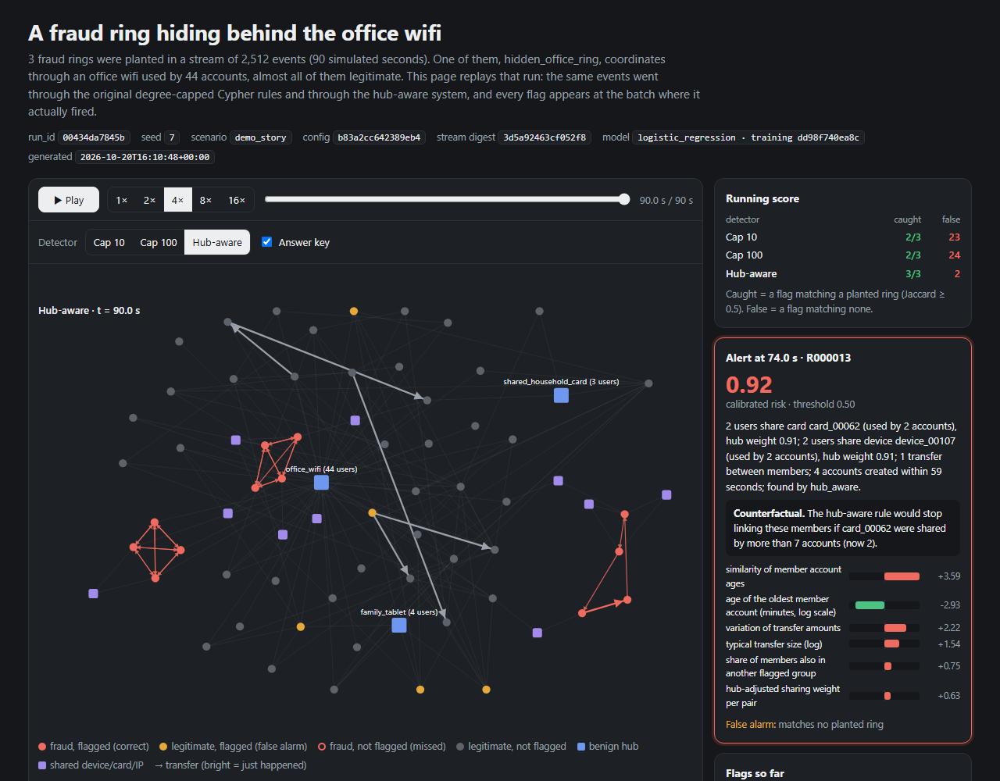
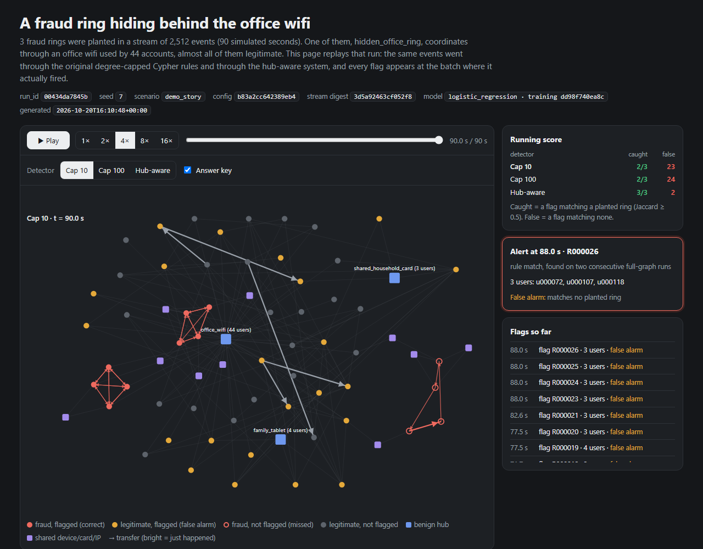
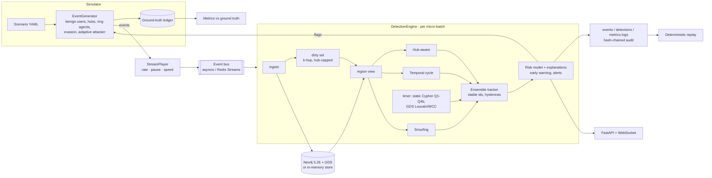
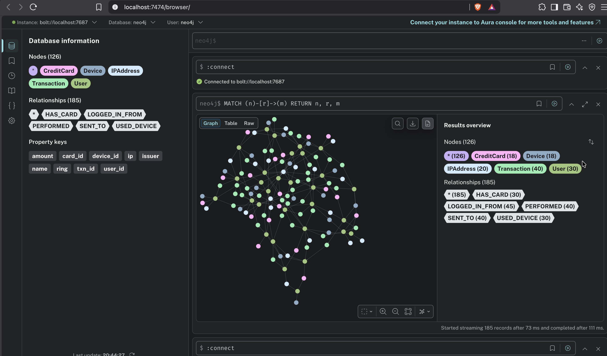
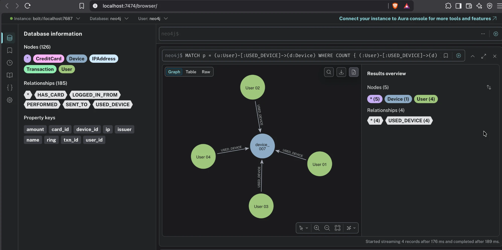
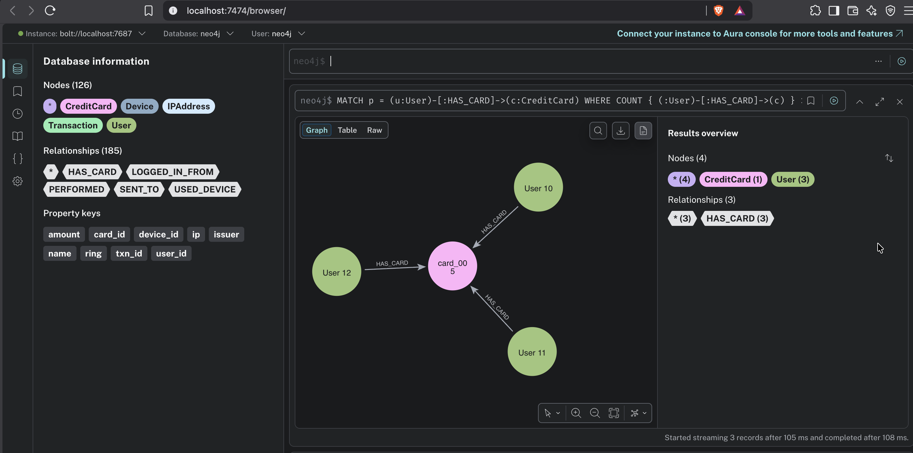
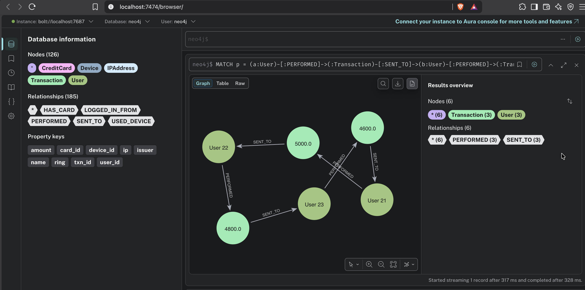
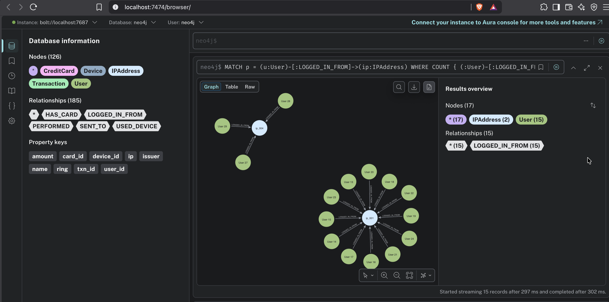
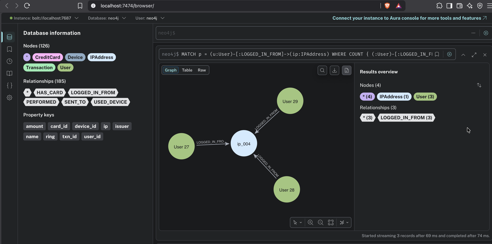
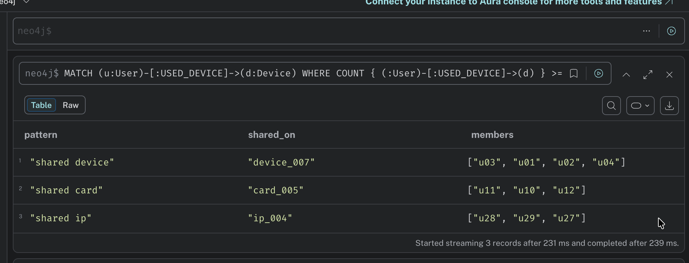

# Hub-Aware Incremental Fraud Ring Detection on Streaming Transaction Graphs

BCSE406L - NoSQL Databases
Sanjay Kumar S (23BCE1248) · Roshan Parveen (23BCE1256)

This project started as a small Neo4j course model: planted fraud rings and
Cypher queries with a hard degree cap (see [Course baseline](#course-baseline)).
It is now a streaming research system with these parts:

- **Simulator:** a deterministic, real-time graph simulator. Legitimate users,
  benign hubs (office wifi, carrier NAT, family devices) and fraud rings that
  form, grow, mutate, evade and dissolve.
- **Detection:** an incremental engine that re-evaluates only the part of the
  graph each micro-batch touches, on Neo4j or an equivalent in-memory store.
- **Hub-aware weighting:** replaces the hard degree cap, so a ring hiding behind
  a busy hub can still be recovered while the hub's legitimate users are not
  flagged.
- **Explainable risk scoring:** a calibrated model gives every flag a reason,
  feature contributions, an evidence subgraph and a counterfactual.
- **Evaluation:** metrics against ground truth, structured logs, a
  tamper-evident audit trail and deterministic replay.

`master_prompt.md` is the specification. Milestone status is
[at the bottom](#milestone-status).

## Demo

```bash
pip install -e ".[dev]"
make demo-story        # or: python -m fraudsim.cli demo-story --seed 7 --open
```

This writes `demo/story.html`, an offline, self-contained animated replay of a
real run. A ring hides behind a 44-account office wifi, and the same events go
through the original degree-capped Cypher rules (cap 10 and cap 100) and
through the hub-aware system. The page has:
- play/pause, speed, a scrubber and a detector switch;
- an *answer key* that marks correct flags, false alarms and misses;
- running scores, and alerts that pop up with their explanation at the batch
  where they fired.

Deep links jump to a moment, for example
`story.html#t=60&det=cap10&key=1`.

| Hub-aware system, end of run (answer key on) | Degree cap 10, end of run |
|---|---|
|  |  |

These screenshots are from run `00434da7845b` (seed 7), using the logistic
risk model trained on seeds 101–110. Over the same 2,512 events:

| Approach | Rings caught | False rings | Innocent users flagged |
|---|---|---|---|
| Rules, cap 10 | 2 / 3 | 23 | 52 |
| Rules, cap 100 | 2 / 3 | 24 | 74 |
| Hub-aware + risk model | 3 / 3 | 2 | 8 |

This is a single demonstration run. The cap rules reach the office ring only
through a coincidental 3-cycle among its members; the shared-IP query skips it
because of the cap. Multi-seed results for the paper come from the experiment
harness (Milestone 8).

## Architecture



| Package | Contents |
|---|---|
| `src/fraudsim/simulator/` | Config, world state, ring agents, event generator, stream player, recorder |
| `src/fraudsim/stream/` | Event bus (asyncio queue, Redis Streams) |
| `src/fraudsim/graph/` | Neo4j client, `GraphStore` contract, Neo4j and in-memory stores |
| `src/fraudsim/detectors/` | Detectors, ensemble/tracker, engine, closed-loop runner |
| `src/fraudsim/scoring/` | Features, calibrated scorer, explanations, early warning, training |
| `src/fraudsim/metrics/` | Evaluation vs ground truth, exporters (CSV/Parquet/Prometheus) |
| `src/fraudsim/logging/` | Run logs, audit trail, replay |
| `src/fraudsim/api/` | FastAPI app, live run, WebSocket |
| `src/fraudsim/demo/` | `demo-story` page builder |
| `configs/scenarios/` | baseline, high_noise, hub_heavy, adversarial, scale_sweep, drift, demo_story |

Design notes are in [`docs/simulator.md`](docs/simulator.md),
[`docs/detection.md`](docs/detection.md), [`docs/scoring.md`](docs/scoring.md),
[`docs/metrics.md`](docs/metrics.md) and [`docs/logging.md`](docs/logging.md).

## Quick start

Requirements: Python 3.11, and Docker Desktop for Neo4j and Redis (the
in-memory store works without Docker).

```bash
pip install -e ".[dev,redis]"
docker compose up -d neo4j redis      # Neo4j 5.26 + GDS on 7474/7687, Redis on 6379
```

```bash
fraudsim simulate --scenario adversarial --seed 7            # stream + ground truth -> runs/<id>/
fraudsim detect   --scenario adversarial --seed 42           # simulate + detect + score + metrics + logs
fraudsim detect   --scenario scale_sweep --backend neo4j     # same on a live Neo4j
fraudsim replay   runs/<run_id>                              # re-run detection, must be identical
fraudsim audit-verify runs/<run_id>                          # check the audit hash chain
fraudsim compare-latency --scenario scale_sweep --seed 42    # incremental vs full recompute
fraudsim train-scorer --model logistic_regression            # (re)train the risk model
fraudsim run --scenario baseline --speed 10                  # live JSON event stream
fraudsim api                                                  # FastAPI on :8000 (docs at /docs)
```

The commands above assume `pip install -e .`. Without installing, use
`PYTHONPATH=src python -m fraudsim.cli ...`.

Each `detect` run writes `runs/<run_id>/`:
- `events.jsonl`, `detections.jsonl`, `metrics.jsonl` and `errors.log`;
- `audit.jsonl`;
- `batches.jsonl` and `rings.jsonl`;
- `ground_truth*.jsonl`;
- `metrics/` (summary.json, CSV/Parquet tables, Prometheus text);
- `manifest.json` (seed, config hash, stream digest, model SHA-256).

## Tests

```bash
make test-unit                     # no services needed
pytest -m integration              # needs `docker compose up -d neo4j redis`
make lint
```

The latest reports are in `docs/reports/`; Milestone 6 has 158 passing tests,
including the Neo4j/GDS and Redis integration tests.

## Milestone status

| Milestone | Status |
|---|---|
| M1 Architecture and repo layout | done (unsourced paper numbers replaced by placeholders) |
| M2 Real-time graph simulator | done |
| M3 Incremental detection engine | done |
| M4 Scoring and explainability (+ `demo-story`) | done |
| M5 Metrics | done |
| M6 Logging, audit and replay | done |
| M7 Live React dashboard | next |
| M8 Experiment harness and paper artefacts | planned. `docs/paper` tables are placeholders until real runs fill them |
| M9 Quality bar (CI, README, reproduction guide) | planned |

Known open items:
- `src/fraudsim/experiments/latex_export.py` and `plotting.py` still embed
  hard-coded numbers. They will be replaced with run-derived values in M8.
- `web/` holds the M1 dashboard skeleton, which is rebuilt in M7.

---

## Course baseline

The original course model is unchanged and still runs on its own. It is also
replayed by the new pipeline as `EventGenerator.generate_seed_events()`.

```bash
docker compose up -d neo4j
pip install -r requirements.txt
python seed.py
```

Then open http://localhost:7474 (user `neo4j`, password `fraudring123`), and
paste queries from `queries.cypher` one block at a time. Setup help is in
[`SETUP.md`](SETUP.md), and the original plan is in
[`docs/PLAN.md`](docs/PLAN.md).

### Data model

```
(:User)-[:USED_DEVICE]->(:Device)
(:User)-[:HAS_CARD]->(:CreditCard)
(:User)-[:LOGGED_IN_FROM]->(:IPAddress)
(:User)-[:PERFORMED]->(:Transaction)-[:SENT_TO]->(:User)
```

30 users, 18 devices, 18 cards, 20 IPs, 40 transactions - 126 nodes. Small on
purpose: the whole graph fits on one screen, and because the rings are planted we
know exactly what each query should return.

The pools are wider than the user count on purpose. Sharing in the background
noise is capped at two users per device, card and IP, and noise transfers that
would close a loop are rejected. Without those caps, chance alone puts three
users on the same device and the accidental clusters look identical to a planted
ring. Every group of three or more in the results is deliberate.

### What is planted

| | Pattern | Expected result |
|---|---|---|
| Ring A | u01, u02, u03, u04 share `device_007` | found by Q1 |
| Ring B | u10, u11, u12 share `card_005` | found by Q2 |
| Cycle | u21 → u22 → u23 → u21 | found by Q3 |
| Ring C | u27, u28, u29 share `ip_004` | found by Q4a and Q4b |
| Hub | 12 users share `ip_001` | **not fraud** - office wifi |

Every user carries a `ring` property recording which planted ring it belongs to,
`null` for legitimate users. No detection query reads it - it exists only so the
results can be checked.

### The degree cap

`ip_001` is shared by twelve ordinary users. Any naive shared-attribute query
treats that as a twelve-member fraud ring.

Run Q4a (cap 100) and Q4b (cap 10) back to back. Same query, one number changed.
Q4a returns ring C plus twelve false positives; Q4b returns ring C alone.

The cost: a genuine ring hiding behind a busy node gets skipped too. Precision
bought with recall.

### Results (course baseline)

Screenshots from the Neo4j browser on the seeded graph.

#### The full graph (Q0)

126 nodes, 185 relationships.



#### Shared device ring (Q1)

Four users on `device_007`.



#### Shared card ring (Q2)

Three users on `card_005`.



#### Circular money flow (Q3)

u21 to u22 to u23 and back.



#### Degree cap off (Q4a)

Ring C found, plus twelve false positives from the shared office IP.



#### Degree cap on (Q4b)

Same query, threshold changed from 100 to 10. False positives gone.



#### Summary (Q5)



---

### Measured result: the degree cap

Q4a and Q4b are the same query. The only difference is the degree threshold,
changed from 100 to 10. Measured in the Neo4j browser on the seeded graph:

| | Q4a (no cap) | Q4b (cap = 10) |
|---|---|---|
| Nodes returned | 17 | 4 |
| Users flagged | 15 | 3 |
| Of those, actually fraud | 3 | 3 |
| **Precision** | **20%** | **100%** |
| **Recall** | **100%** | **100%** |
| Query time | 302 ms | 74 ms |

Twelve of the fifteen users Q4a flags are innocent - they share `ip_001`, the
office wifi. The cap removes all twelve, and the query also runs about four
times faster because it stops expanding the hub node at all.

Recall stays at 100% here only because ring C sits behind a low-degree IP. That
is a property of this dataset, not a guarantee: a real ring hiding behind a busy
node would be skipped by the same rule that removes the false positives. The cap
buys precision and speed with recall, and the trade is the honest finding.
